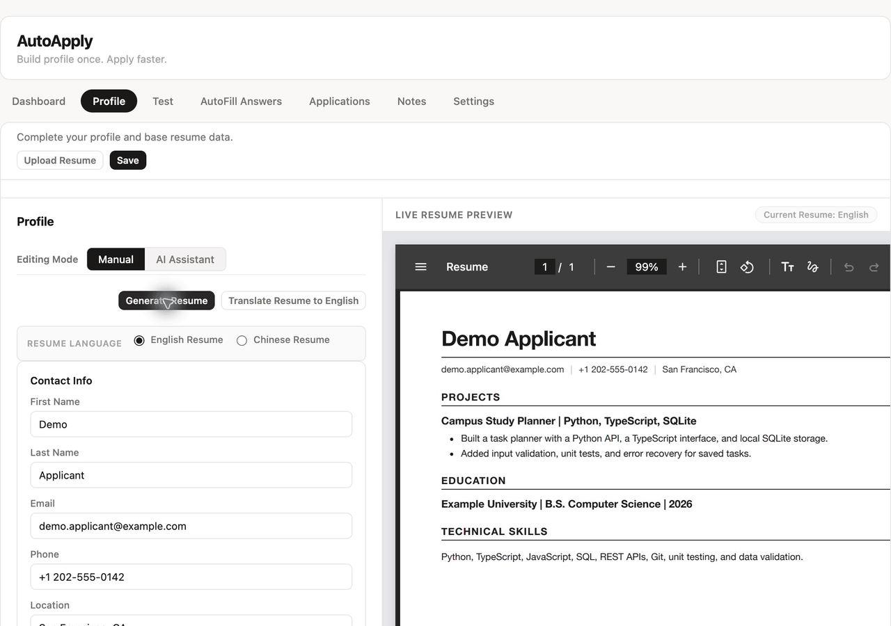
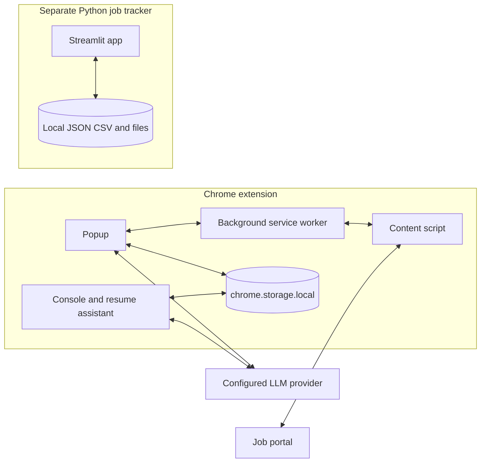

# AutoApply

AI-assisted resume tailoring and application autofill, with a local Python job tracker, 14 resume tools, and 259 tests.

[](https://github.com/YuexinJ778/AutoApply/actions/workflows/ci.yml)
[](tests/job-tracker/)
[](LICENSE)
[](extension/manifest.json)
[](job-tracker/requirements.txt)

## Demo



Console UI replay with fictional data and prerecorded model responses; the A4 HTML is rendered by the production template. See [recording details](docs/demo.md). This clip demonstrates resume editing and tracking; it is not a recording of live provider latency or a complete portal autofill run.

## Why

Job applications repeat the same profile entry, resume edits, and status updates across different websites. AutoApply captures job details, edits a structured resume through local operations, and fills supported forms while you review the result.

## Features

| Stage | Implemented behavior |
| --- | --- |
| **Capture** | Extract visible page text and job metadata; normalize job details from the current tab. |
| **Tailor** | Edit English or Chinese resumes through 14 local operations; review changes in the A4 preview and retain resume versions. |
| **Autofill** | Map fields to profile values, reuse confirmed field knowledge, and attach generated resumes on supported forms; include HSBC/SuccessFactors matching rules. |
| **Track** | Keep application status, notes, and application-specific resume drafts in the extension; use the separate Python tracker for companies, files, calendars, and reminders. |
| **Prepare** | Generate job summaries, key-skill guidance, and resume suggestions; keep per-application notes with an AI notes assistant. |

The extension and Python job tracker are separate applications with independent storage. They do not synchronize. Automated interview preparation is on the roadmap.

## Architecture



The popup captures the active job page through the background worker and content script. The extension sends selected job, resume, or notes context directly to the configured provider and stores the resulting application data locally. The independent Streamlit tracker stores its own files; there is no extension-to-Python API bridge. See [architecture and site-specific matching](docs/architecture.md).

## Agent design

The resume assistant asks the model for a JSON `functionCalls` plan and executes validated local operations. It does not use provider-native tools APIs.

| Category | Operations | Examples |
| --- | ---: | --- |
| Contact | 3 | `setContactField`, `addContactLink` |
| Sections | 4 | `addSection`, `moveSection` |
| Entries | 3 | `addEntry`, `deleteEntry` |
| Lines | 4 | `addLine`, `setLine` |
| **Total** | **14** | [Full names, arguments, and behavior](docs/tools.md) |

Each chat turn plans one batch of at most **10 calls**. Provider configuration is checked at the request boundary; **Test Connection** in Settings is a separate user action. Before execution, a model self-check reviews the plan, and the local executor independently validates allowed names, arguments, and target IDs. It runs on a clone and saves the result only after success. A missing target allows one recovery attempt; unresolved or rejected edits ask for clarification or stop. An oversized plan gets one reduction request.

PDF import uses a separate loop: at most **120 rounds**, **3 AI attempts per stage**, and **3 rejected proposals per step**. Completed earlier batches may remain saved if a later import stage stops. These are bounded workflows; a 10-call batch is not a global agent step limit. See the [harness details](docs/tools.md#configuration-and-failure-handling).

## Engineering highlights

- **Validated edits with failure isolation:** the [resume executor](extension/options/resumeFunctions.js) checks each batch and returns the original resume when execution fails.
- **Credential and editing-payload boundaries:** [provider requests](extension/lib/api.js) authenticate separately; the [local validator](extension/options/resumeFunctions.js) rejects full resume/profile/application objects inside tool arguments. Relevant resume context still reaches the provider.
- **Resume provenance:** the [artifact registry](extension/storage/resumeRegistryStore.js) records resume IDs, version IDs, and storage references for generated artifacts.
- **Recoverable local persistence:** [tracker storage](job-tracker/storage.py) uses atomic writes and rolling backups, covered by [storage tests](tests/job-tracker/test_storage.py).
- **Date and export behavior:** [calendar tests](tests/job-tracker/test_calendar_utils.py) cover DST boundaries; [export tests](tests/job-tracker/test_dashboard_export.py) check filtering, visible fields, and password masking.

## Quick start

Use desktop **Chrome 105+** and a provider API key. No extension build step or Python installation is required for the browser workflow.

1. Clone `https://github.com/YuexinJ778/AutoApply.git`, then open `chrome://extensions/`, enable **Developer mode**, and **Load unpacked** → the repository's `extension/` directory.
2. Open **AutoApply → Console → Profile**. Enter your contact details and base resume; save them. The bundled mock profile is a fallback fixture, so configure your own profile before using real forms.
3. Open **Settings**, select **minimax**, enter your API key, and click **Save Settings**, then **Test Connection**. Other provider settings exist; MiniMax is the documented starting path.
4. Open a job posting and click **Start Apply** in the popup. Review the tailored resume, follow the site's Apply link, then reopen the popup on the application form to autofill supported fields.
5. Review each filled field and attachment, submit through the website yourself, and manage the saved application in **Console → Applications**.

`:has()` styling requires Chrome 105 or later; the browser-version matrix has not been exhaustively tested. Ollama is configurable, but the current shared settings guard also requires a nonempty API-key field; a keyless Ollama setup is not documented here.

For the optional local tracker, use **Python 3.12+** (tested on 3.14.3):

```bash
python3 -m venv .venv
source .venv/bin/activate
python -m pip install -r job-tracker/requirements.txt
python -m streamlit run job-tracker/app.py --server.address 127.0.0.1 --browser.gatherUsageStats false
```

No `.env` variables are consumed by either application. Provider keys belong in Console Settings, not an environment file; [the configuration reference](job-tracker/.env.example) records this explicitly. The tracker needs no API key. `pdflatex` is optional for its LaTeX compilation feature. See the [tracker guide](job-tracker/README.md).

Run the existing Python tests from the repository root:

```bash
python -m pip install pytest==9.2.0
python -m pytest -q
```

Package the extension with `python3 scripts/package_extension.py`; the ZIP is written under `build/`.

## Privacy & Security

Profiles, resumes, API keys, settings, application records, and notes stay in the extension's `chrome.storage.local` until a feature sends selected context to a configured provider. AI requests can include job text, relevant resume content, instructions, conversations, or notes. PDF import can send the selected PDF to a provider that supports it. API keys authenticate those requests; local storage is not encrypted by this project.

The separate tracker stores JSON, CSV, resumes, attachments, notes, and reminders under its local `data/`, `applications/`, and `backups/` directories, which Git ignores. It does not call an LLM provider. Its optional application-account/password fields are saved as plain text.

| Manifest permission | Use |
| --- | --- |
| `storage` | Persist profiles, settings, resume versions, and application state locally. |
| `tabs` | Read application-tab URL/state, follow navigation, and reuse the Console tab. |
| `activeTab` | Access the page after the user invokes the extension. |
| `scripting` | Inject extraction/autofill scripts when an existing tab has no content script. |
| `downloads` | Save generated resume PDFs and exported files. |
| `debugger` | Use Chrome DevTools Protocol for application-button clicks and A4 PDF generation. |
| `<all_urls>` | Work across job-portal domains and reach configured provider endpoints, including local endpoints. |

Content scripts match `<all_urls>`; the synthetic fallback profile is a web-accessible resource on matching pages. Autofill runs in prepare-only mode. **Final application submission is a user action.**

## Evaluation

The repository provides tool and test counts; autofill accuracy and end-to-end speed have not been established by a retained benchmark dataset.

| Claim | Evidence as of 2026-11-05 | Sample / method |
| --- | --- | --- |
| 14 resume operations | [Executable allowlist](extension/options/resumeFunctions.js) and [tools table](docs/tools.md) | 3 contact + 4 section + 3 entry + 4 line operations. |
| 259 tests | [Python suite](tests/job-tracker/) and [CI runs](https://github.com/YuexinJ778/AutoApply/actions/workflows/ci.yml) | 259 collected tests; 294 subtests are reported separately, not added to the test count. |
| 90% autofill | **Unverified** | Platform count, application count, field-level outcomes, and measurement date were not retained. |
| 60× / 5 minutes → 5 seconds | **Unverified** | No retained paired manual/tool timing runs or measured date. |

Python tests cover the standalone tracker. Extension syntax checks, UI replay, and a passing Python suite do not establish portal coverage or live model quality. See [measurement definitions and the benchmark protocol](docs/evaluation.md).

## Limitations & Roadmap

Website support varies, and the current UI replay does not replace an end-to-end browser benchmark.

- CAPTCHA, login, MFA, and portal-specific steps require user interaction.
- Custom widgets, dynamic forms, cross-origin frames, and file-upload controls can need site-specific handling.
- Provider failures and incorrect model proposals can stop editing; review the generated content and filled fields.
- The extension and tracker have independent storage, without synchronization; the tracker is single-user.
- Local data is not encrypted by this project, and broad host/debugger permissions remain enabled for existing features.

Next steps:

1. Record the complete capture → tailor → autofill → track flow with fictional data.
2. Add a reproducible portal benchmark and paired manual/tool timing measurements.
3. Add extension unit tests and lint checks; current CI runs Python tests, JS syntax, and packaging.
4. Design explicit extension/tracker data exchange and narrower on-demand host access.
5. Build interview-preparation workflows; current preparation features are job guidance and notes.

## Contributors & License

| Contributor | Implemented work |
| --- | --- |
| [yushliu](https://github.com/yushliu) | Primary implementation of the Chrome extension workflow and resume assistant: [validated operations](extension/options/resumeFunctions.js), [AI planning and recovery](extension/lib/api.js), and [resume version tracking](extension/storage/resumeRegistryStore.js). Implemented the [Python tracker](job-tracker/app.py), [storage](job-tracker/storage.py), [calendar](job-tracker/calendar_utils.py), and [tests](tests/job-tracker/). |
| [YuexinJ778](https://github.com/YuexinJ778) | Implemented [resume import, application notes, and custom AI instructions](extension/options/options.js); contributed extension fixes and maintains the public repository. |

Released under the [MIT License](LICENSE).
