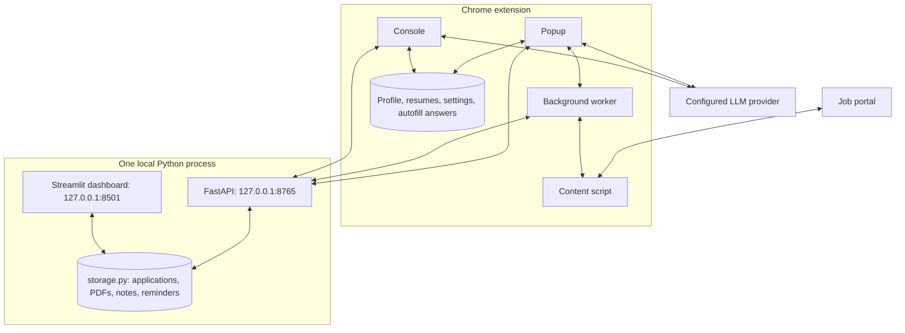

# AutoApply

AutoApply is a local job-application agent: a Chrome extension tailors your resume and fills application forms, and a local Python service tracks every application. It has 19 tools: 14 resume and 5 tracker, covered by 500 automated tests.

[](https://github.com/YuexinJ778/AutoApply/actions/workflows/ci.yml)
[](tests/)
[](LICENSE)
[](extension/manifest.json)
[](server/requirements.txt)

## Demo


One fictional application in five steps: **Start Apply** in the popup → the resume assistant edits the A4 resume → the form is filled and the tailored PDF attached → the application appears in the shared dashboard → the Tracker Assistant sets the status and adds an interview reminder. All names and values are fictional, and model responses come from a local fixture. [Screenshots and setup](docs/demo.md).

## Why

Every application asks for the same profile details, a resume adjusted to the role, and a status you have to remember to update. AutoApply does the repetitive parts in the browser and keeps one record per application on your machine. You review each change and submit each application yourself.

## Features

| Stage | What it does |
| --- | --- |
| **Capture** | Reads the title, company, location and description from the job tab. **Start Apply** or **Save Job** creates one tracker record per job URL. |
| **Tailor** | Edits English or Chinese resumes through 14 validated operations with an A4 live preview. Start Apply tailors a copy for that application and leaves your saved resume unchanged. |
| **Autofill** | Fills fields from your profile and saved answers, attaches the tailored PDF, and records how many detected fields it filled. Includes site rules for HSBC and SuccessFactors forms. It never submits. |
| **Track** | One dashboard for every application: status, applied date, PDF versions, notes, files and a reminder calendar. **I have submitted** in the popup records the applied date. |
| **Assist** | The Tracker Assistant answers questions across your notes and changes status, applied date, notes or reminders from one sentence. It asks when a company matches more than one application. |

## Architecture



One Python process owns the only application store. Streamlit and a FastAPI thread run in that process and share `storage.py` and one lock, so there are no copies to sync. The extension keeps your profile, resumes, provider keys and autofill answers in `chrome.storage.local`. It reaches the tracker through the token-protected local API; content scripts go through the background worker. All LLM requests come from the extension; the server makes none. See [architecture](docs/architecture.md) and the [local API contract](docs/local-api.md).

## Agent design

Both assistants ask the model for a JSON `functionCalls` plan, not free text, and execute it only after validation. Provider-native tool APIs are not used.

| Category | Operations | Examples |
| --- | ---: | --- |
| Contact | 3 | `setContactField`, `addContactLink` |
| Sections | 4 | `addSection`, `moveSection` |
| Entries | 3 | `addEntry`, `deleteEntry` |
| Lines | 4 | `addLine`, `setLine` |
| Tracker | 5 | `setJobStatus`, `addReminder` |
| **Total** | **19** | [Names, arguments and behavior](docs/tools.md) |

- **Batch limit:** one plan per turn, at most **10 calls**. An oversized plan gets one request to shrink it.
- **Checks before execution:** a model self-check reviews the plan, then a local validator checks function names, arguments and target IDs. The server validates tracker batches again with the dashboard's own rules.
- **Resume edits** run on a clone and are saved only when every call succeeds. A missing target gets one recovery attempt; otherwise the assistant asks or stops.
- **Tracker batches** are resolved on the server by company and optional job title. If any call is ambiguous or matches nothing, nothing is written and the assistant asks which application you mean.
- **PDF import** runs its own loop: at most **120 rounds**, **3 AI attempts per stage** and **3 rejected proposals per step**. Batches completed before a later stage stops stay saved.

See the [harness details](docs/tools.md#configuration-and-failure-handling).

## Engineering highlights

- **One store, no sync:** the dashboard and API share [storage.py](server/storage.py) and one process lock. Writes are atomic and keep the previous version as a backup; [storage tests](tests/server/test_storage.py) and [concurrency tests](tests/server/test_tracker_storage.py) cover recovery and simultaneous writers.
- **All-or-nothing tracker actions:** [`execute_tracker_actions`](server/storage.py) resolves and validates the whole batch before the first write; [tests](tests/server/test_tracker_actions.py) cover unique, ambiguous and missing targets.
- **Validated resume edits:** the [resume executor](extension/options/resumeFunctions.js) runs each batch on a clone and returns the original on failure; [tests](tests/extension/resumeFunctions.test.js) cover all 14 operations and rollback.
- **Per-application resume copies:** Start Apply sends a copy of your saved resume through the same plan, self-check and validator ([api.js](extension/lib/api.js)); [tests](tests/extension/currentResumePipeline.test.js) check that the original stays unchanged.
- **Local API boundary:** loopback only, a Bearer token on every data endpoint, and saved account/password fields removed from every response ([api.py](server/api.py), [tests](tests/server/test_api.py)).
- **Time zones:** reminders store an IANA time zone and resolve daylight-saving gaps and repeated hours ([calendar_utils.py](server/calendar_utils.py), [tests](tests/server/test_calendar_utils.py)).

## Quick start

You need desktop Chrome, Python 3.14 (the version CI tests), and a model provider: MiniMax, OpenAI or DeepSeek with an API key, or a local Ollama model. No environment variables are needed: provider keys stay in the extension, and the tracker creates its own token.

1. Clone the repository:
   ```bash
   git clone https://github.com/YuexinJ778/AutoApply.git
   cd AutoApply
   ```
2. Install and start the tracker with one command:
   ```bash
   python -m pip install -r server/requirements.txt
   python -m streamlit run server/app.py --server.address 127.0.0.1 --browser.gatherUsageStats false
   ```
   The dashboard opens at `http://127.0.0.1:8501`. Its first browser tab starts the API on port `8765`.
3. Open `chrome://extensions/`, turn on **Developer mode**, click **Load unpacked** and choose the repository's `extension/` folder.
4. In **Console → Settings**, choose your provider and save its model and key. Copy the token from the dashboard's **Settings → Local API** into **Local Tracker**, then test both connections. In **Profile**, enter your contact details and resume, then save.
5. Open a job posting and click **Start Apply**. Open the application form and click **AutoFill Form**. Review the fields and the attached PDF, submit on the website yourself, then click **I have submitted**.

**Applications** opens the dashboard; **Console → Tracker** holds notes and the Tracker Assistant. If the tracker is not running, capture, tailoring and filling still work, and tracking shows a separate error. The [tracker guide](server/README.md) covers the dashboard.

Run all tests from the repository root (Node.js 24+):

```bash
python -m pip install -r tests/requirements.txt
python -m pytest -q
node --test tests/extension/*.test.js
```

CI also runs Ruff (`E4,E7,E9,F`), ESLint's recommended rules, a JavaScript syntax check and extension packaging (`python3 scripts/package_extension.py`). See the [workflow](.github/workflows/ci.yml).

## Privacy & Security

Your data stays on your machine; only the LLM requests you start leave it.

| Data | Where it lives |
| --- | --- |
| Profile, resumes, provider keys, settings, autofill answers | The extension's `chrome.storage.local`. Provider keys are sent only to the configured provider. |
| Applications, PDF versions, files, notes, reminders | `server/data/`, `server/applications/` and `server/backups/`, all excluded from Git. The dashboard and the extension use this one store. |
| Local API | Listens only on `127.0.0.1`. Every data endpoint needs the Bearer token (`/api/health` is public). Responses never include saved account or password fields. |
| LLM requests | The extension sends job text, resume content, your instructions, the conversation and, for the Tracker Assistant, saved notes. PDF import can send the selected PDF. The Python service sends nothing. |

This project does not encrypt local data. The tracker's optional website account and password fields are stored as plain text. Tracker chat stays in the current tab unless you save a reply to notes.

| Permission | Why |
| --- | --- |
| `storage` | Save your profile, settings, resume versions and autofill answers. |
| `tabs` | Read the application tab's URL and state, follow navigation and reuse the Console tab. |
| `activeTab` | Access the page you invoke the extension on. |
| `scripting` | Inject extraction and autofill scripts into tabs that have none. |
| `downloads` | Save generated resume PDFs and exported files. |
| `debugger` | Print A4 resume PDFs through the Chrome DevTools Protocol (`Page.printToPDF`). |
| `<all_urls>` | Work on any job portal and reach your provider's endpoint, including local ones. |

Autofill only prepares the form. **Submitting an application is always your action.**

## Evaluation

The verified numbers are the tool count and the tests; autofill coverage has not yet been measured on real job sites.

| Measure | Result | Evidence |
| --- | --- | --- |
| Resume operations | 14: 3 contact, 4 section, 3 entry, 4 line | [Allowlist](extension/options/resumeFunctions.js), [tools](docs/tools.md) |
| Tracker operations | 5, for **19 tools** in total | [Registry](extension/options/trackerFunctions.js), [tools](docs/tools.md) |
| Python tests | 367 passed, plus 294 subtests | [Server tests](tests/server/), [CI](https://github.com/YuexinJ778/AutoApply/actions/workflows/ci.yml) |
| Extension tests | 133 passed | [Node tests](tests/extension/), [CI](https://github.com/YuexinJ778/AutoApply/actions/workflows/ci.yml) |
| Lint and packaging | Ruff, ESLint, JavaScript syntax, extension ZIP | [Workflow](.github/workflows/ci.yml) |

Autofill **coverage** is `Σfilled / Σdetected` across applications, using each application's latest record with `detected > 0`. The tracker stores these counts for every autofill run. It measures how many fields were filled, not whether the answers are right. The demo form is an integration check, not a benchmark; a [real-portal benchmark](https://github.com/YuexinJ778/AutoApply/issues/3) is planned. No time savings are claimed. See [Evaluation](docs/evaluation.md).

## Limitations & Roadmap

Support varies by website, and you review everything before it is sent.

- CAPTCHA, login, multi-factor and portal-specific steps need you.
- Custom widgets, dynamic forms, cross-origin frames and some file inputs need site-specific handling.
- A provider error or a rejected plan stops an edit; review generated content and filled fields.
- Start Apply PDFs support ASCII text only. Use the Console's PDF export for Chinese resumes.
- The tracker is single-user, and tracking needs its local API running. Older extension application data can only be imported.
- Host access is broad, the `debugger` permission is required for PDFs, and local data is not encrypted.
- Resumes saved before the current Profile format can only be tailored with MiniMax. The provider settings check needs a non-empty key field for Ollama.

Next steps:

1. [Benchmark autofill coverage on real job portals](https://github.com/YuexinJ778/AutoApply/issues/3), with raw field counts and timed manual and assisted runs.
2. [Support custom controls and embedded forms](https://github.com/YuexinJ778/AutoApply/issues/4), including resume-attachment checks.
3. Request host access per site instead of for all URLs.
4. Add interview preparation built on saved notes and reminders.

## Contributors & License

| Contributor | Implemented work |
| --- | --- |
| [yushliu](https://github.com/yushliu) | Primary implementation of the Chrome extension workflow and resume assistant: [validated operations](extension/options/resumeFunctions.js), [AI planning and recovery](extension/lib/api.js), and [resume version tracking](extension/storage/resumeRegistryStore.js). Implemented the [Python tracker](server/app.py), [storage](server/storage.py), [calendar](server/calendar_utils.py), and [tests](tests/server/). |
| [YuexinJ778](https://github.com/YuexinJ778) | Implemented [resume import, application notes, and custom AI instructions](extension/options/options.js); contributed extension fixes and maintains the public repository. |

Released under the [MIT License](LICENSE).
