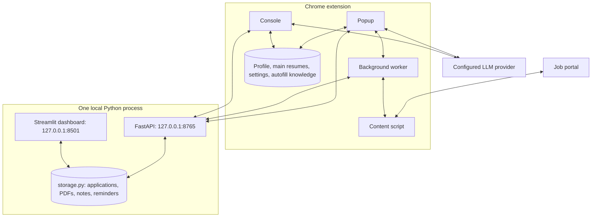

# AutoApply

AI-assisted resume tailoring, application autofill and local job tracking, with 19 tools: 14 resume and 5 tracker. Tested with 367 Python tests and 133 extension tests (500 total).

[](https://github.com/YuexinJ778/AutoApply/actions/workflows/ci.yml)
[](tests/)
[](LICENSE)
[](extension/manifest.json)
[](server/requirements.txt)

## Demo


Fictional application: **Capture job → Tailor resume → Autofill → Track → Add reminder**. [Screenshots and demo setup](docs/demo.md).

## Why

Job applications repeat the same profile entry, resume edits, and status updates across different websites. AutoApply captures job details, edits a structured resume through local operations, and fills supported forms while you review the result.

## Features

| Stage | Implemented behavior |
| --- | --- |
| **Capture** | Extract visible page text and job metadata; normalize job details from the current tab. |
| **Tailor** | Edit English or Chinese resumes through 14 local operations; review changes in the A4 preview and retain resume versions. |
| **Autofill** | Map fields to profile values, reuse confirmed field knowledge, and attach generated resumes on supported forms; include HSBC/SuccessFactors matching rules. |
| **Track** | Save jobs, tailored PDF versions, autofill coverage and explicit submission confirmations to the local Python tracker; Applications opens its dashboard. |
| **Tracker assistant** | Ask about saved notes or request status/date changes, appended notes, and reminders; the server resolves the intended application. |

## Architecture



The Python service owns the only writable application store. The dashboard and FastAPI share `storage.py` and one process lock; opening the first dashboard tab starts the API. The extension keeps Profile, main resumes, provider keys and autofill knowledge locally. Content scripts send tracking messages through background; popup and Console call the API directly. LLM requests originate in the extension. See [architecture and site-specific matching](docs/architecture.md).

## Agent design

The assistants ask the model for a JSON `functionCalls` plan. Resume edits execute locally; tracker operations execute through the local API. Provider-native tools APIs are not used.

| Category | Operations | Examples |
| --- | ---: | --- |
| Contact | 3 | `setContactField`, `addContactLink` |
| Sections | 4 | `addSection`, `moveSection` |
| Entries | 3 | `addEntry`, `deleteEntry` |
| Lines | 4 | `addLine`, `setLine` |
| Tracker | 5 | `setJobStatus`, `addReminder` |
| **Total** | **19** | [Full names, arguments, and behavior](docs/tools.md) |

Each chat turn plans one batch of at most **10 calls**. Tracker changes use a model self-check, a separate local allowlist/argument validator and the server’s existing storage validation. The server matches company and optional job title; ambiguous or missing targets return a clarification without executing the batch. Reminder times use the browser’s IANA time zone and the existing calendar validation. Console resume editing follows its existing flow: Provider configuration is checked before a request. Before execution, a model self-check reviews the plan, and the local executor independently validates allowed names, arguments, and target IDs. It runs on a clone and saves the result only after success. A missing target allows one recovery attempt; unresolved or rejected edits ask for clarification or stop. An oversized plan gets one reduction request.

PDF import uses a separate loop: at most **120 rounds**, **3 AI attempts per stage**, and **3 rejected proposals per step**. Completed earlier batches may remain saved if a later import stage stops. See the [harness details](docs/tools.md#configuration-and-failure-handling).

## Engineering highlights

- **Validated edits with failure isolation:** the [resume executor](extension/options/resumeFunctions.js) checks each batch and returns the original resume when execution fails; [extension tests](tests/extension/resumeFunctions.test.js) cover validation, all 14 operations, cloning, and rollback.
- **Credential and editing-payload boundaries:** [provider requests](extension/lib/api.js) authenticate separately; the [local validator](extension/options/resumeFunctions.js) rejects full resume/profile/application objects inside tool arguments.
- **Application resume copies:** Start Apply plans and self-checks edits to the current saved Profile resume, validates and executes them on a copy, then generates application artifacts without changing the main resume.
- **Resume provenance:** the [artifact registry](extension/storage/resumeRegistryStore.js) records resume IDs, version IDs, and storage references for generated artifacts.
- **Recoverable local persistence:** [tracker storage](server/storage.py) uses atomic writes and rolling backups, covered by [storage tests](tests/server/test_storage.py).
- **Date and export behavior:** [calendar tests](tests/server/test_calendar_utils.py) cover DST boundaries; [export tests](tests/server/test_dashboard_export.py) check filtering, visible fields, and password masking.

## Quick start

Use desktop **Chrome 105+**, **Python 3.12+**, and a configured model provider: **MiniMax, OpenAI, DeepSeek or Ollama**.

1. Clone the repository and enter it:
   ```bash
   git clone https://github.com/YuexinJ778/AutoApply.git
   cd AutoApply
   ```
2. Install the Python dependencies, then launch the dashboard and local API with one command:
   ```bash
   python -m pip install -r server/requirements.txt
   python -m streamlit run server/app.py --server.address 127.0.0.1 --browser.gatherUsageStats false
   ```
   Open the dashboard at `http://127.0.0.1:8501`; its first browser session starts the API on port `8765`.
3. Open `chrome://extensions/`, enable **Developer mode**, and **Load unpacked** → the repository's `extension/` directory.
4. In **Console → Settings**, select your provider and save its model/key. Copy the dashboard's **Settings → Local API** token into **Local Tracker**. Test both connections. Enter and save your contact details and base resume in **Profile**.
5. Open a job posting and click **Start Apply**. Review the tailored PDF, follow the site's Apply link, and click **AutoFill Form** on the form. Review the fields and attachment, submit through the website yourself, then click **I have submitted**. **Applications** opens the shared dashboard; **Console → Tracker** manages notes and agent requests.

The tracker needs no LLM key. `pdflatex` is optional for its LaTeX compilation feature. If the tracker is unavailable, capture, tailoring and filling can continue, with a separate tracking error and no offline queue. See the [tracker guide](server/README.md).

Run both test suites from the repository root with Python and **Node.js 24+**:

```bash
python -m pip install -r tests/requirements.txt
python -m pytest -q
node --test tests/extension/*.test.js
```

Lint checks use Ruff's `E4,E7,E9,F` rules and ESLint's recommended rules:

```bash
python -m pip install ruff==0.17.0
npm ci --prefix scripts --ignore-scripts
ruff check --select E4,E7,E9,F server tests scripts
npm --prefix scripts run lint
```

Package the extension with `python3 scripts/package_extension.py`; the ZIP is written under `build/`.

## Privacy & Security

| Data or boundary | Storage and transmission |
| --- | --- |
| Profile, main resumes, provider keys, settings and autofill knowledge | Saved in the extension's `chrome.storage.local`. Provider keys authenticate requests to the configured provider. |
| Applications, PDF versions, attachments, notes and reminders | Saved under `server/data/`, `server/applications/` and `server/backups/`, excluded from Git. The dashboard and extension use this single store. |
| Local API | Binds only to `127.0.0.1`; data endpoints require a Bearer token (`/api/health` is public). Responses omit saved application accounts and passwords. |
| LLM requests | The extension sends relevant job text, resume content, user instructions, conversations or saved notes to the chosen provider. PDF import can send the selected PDF to a provider that supports it. The Python service makes no LLM requests. |

Local data is not encrypted by this project. The tracker's optional application-account/password fields are plain text on disk. Older extension application keys remain read only for explicit import. Tracker chat stays in the current tab until a reply is explicitly saved to shared notes.

| Manifest permission | Use |
| --- | --- |
| `storage` | Persist Profile, settings, main resume versions and autofill knowledge locally. |
| `tabs` | Read application-tab URL/state, follow navigation, and reuse the Console tab. |
| `activeTab` | Access the page after the user invokes the extension. |
| `scripting` | Inject extraction/autofill scripts when an existing tab has no content script. |
| `downloads` | Save generated resume PDFs and exported files. |
| `debugger` | Generate A4 resume PDFs through Chrome DevTools Protocol (`Page.printToPDF`). |
| `<all_urls>` | Work across job-portal domains and reach configured provider endpoints, including local endpoints. |

Content scripts match `<all_urls>`; the synthetic fallback profile is a web-accessible resource on matching pages. Autofill runs in prepare-only mode. **Final application submission is a user action.**

## Evaluation

The implementation and test evidence are linked below.

| Measure | Result | Evidence |
| --- | --- | --- |
| Resume operations | 14: 3 contact, 4 section, 3 entry, 4 line | [Executable allowlist](extension/options/resumeFunctions.js), [tools table](docs/tools.md) |
| Tracker operations | 5; **19 tools total** with resume operations | [Tracker registry](extension/options/trackerFunctions.js), [tools table](docs/tools.md) |
| Python tests | 367 passed; 294 subtests | [Tracker test suite](tests/server/), [CI runs](https://github.com/YuexinJ778/AutoApply/actions/workflows/ci.yml) |
| Extension tests | 133 passed: resume validation, tool documentation, tracker client, background/content routing, popup workflows, read-only import, profile storage, server notes and summary | [Node test suite](tests/extension/), [CI runs](https://github.com/YuexinJ778/AutoApply/actions/workflows/ci.yml) |
| Chrome fixture coverage | **5/5 (100%)**, 1 application on 1 fictional local site, 2026-11-05 | [Raw sample and scope](docs/evaluation.md#measured-local-fixture) |
| Lint and packaging | Ruff correctness rules, ESLint recommended, JavaScript syntax, and ZIP packaging | [CI workflow](.github/workflows/ci.yml) |

Autofill **coverage** is `Σfilled / Σdetected`, using only the latest stored sample per application with `detected > 0`. The measured local fixture is a demonstration, not a real-portal benchmark. Counts refer to distinct scanned controls and do not measure answer correctness. See [measurement scope and raw counts](docs/evaluation.md).

## Limitations & Roadmap

Autofill support varies by website.

- CAPTCHA, login, MFA, and portal-specific steps require user interaction.
- Custom widgets, dynamic forms, cross-origin frames, and file-upload controls can need site-specific handling.
- Provider failures and incorrect model proposals can stop editing; review the generated content and filled fields.
- Console supports English/Chinese resume editing and preview. Start Apply PDFs currently support ASCII text only; use Console PDF export for Chinese.
- The tracker is single-user. Application tracking and notes require its running local API; older extension applications are available only for import.
- Local data is not encrypted by this project; current features use broad host access and the debugger permission.
- Current Profile resumes support the configured provider for tailoring; the fallback for older resume data requires MiniMax. The shared provider-settings guard requires a nonempty API-key field for Ollama.

Next steps:

1. [Expand the reproducible coverage benchmark](https://github.com/YuexinJ778/AutoApply/issues/3), including raw portal field counts and paired manual/assisted timing measurements.
2. [Improve custom controls and embedded forms](https://github.com/YuexinJ778/AutoApply/issues/4), including resume-attachment checks.
3. Narrow host access through on-demand permissions.
4. Extend interview preparation using the shared notes and reminders.

## Contributors & License

| Contributor | Implemented work |
| --- | --- |
| [yushliu](https://github.com/yushliu) | Primary implementation of the Chrome extension workflow and resume assistant: [validated operations](extension/options/resumeFunctions.js), [AI planning and recovery](extension/lib/api.js), and [resume version tracking](extension/storage/resumeRegistryStore.js). Implemented the [Python tracker](server/app.py), [storage](server/storage.py), [calendar](server/calendar_utils.py), and [tests](tests/server/). |
| [YuexinJ778](https://github.com/YuexinJ778) | Implemented [resume import, application notes, and custom AI instructions](extension/options/options.js); contributed extension fixes and maintains the public repository. |

Released under the [MIT License](LICENSE).
