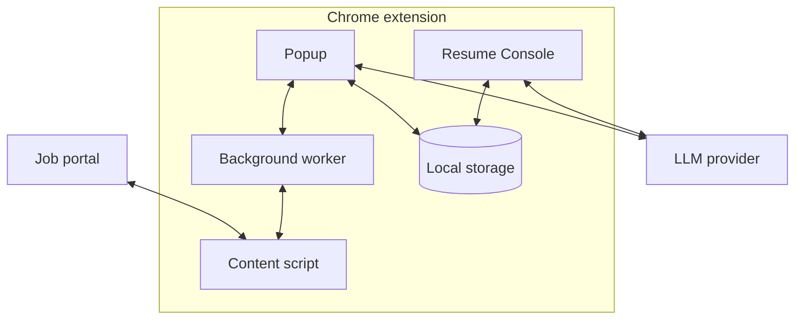

# AutoApply

AI-assisted resume tailoring and application autofill, with a local Python job tracker, 14 resume tools, 331 Python tests, and 70 extension tests.

[](https://github.com/YuexinJ778/AutoApply/actions/workflows/ci.yml)
[](tests/)
[](LICENSE)
[](extension/manifest.json)
[](server/requirements.txt)

**Merge progress (M2):** job capture, tailored PDFs, autofill coverage and explicit submission confirmation now reach the local tracker API. Legacy local application/notes cleanup follows in M3. The demo below shows the earlier workflow. [Tracker setup and validation](docs/tracker-extension.md).

## Demo


Fictional profile: **Edit resume → A4 preview → Autofill contact fields → Track**. [Demo details](docs/demo.md).

## Why

Job applications repeat the same profile entry, resume edits, and status updates across different websites. AutoApply captures job details, edits a structured resume through local operations, and fills supported forms while you review the result.

## Features

| Stage | Implemented behavior |
| --- | --- |
| **Capture** | Extract visible page text and job metadata; normalize job details from the current tab. |
| **Tailor** | Edit English or Chinese resumes through 14 local operations; review changes in the A4 preview and retain resume versions. |
| **Autofill** | Map fields to profile values, reuse confirmed field knowledge, and attach generated resumes on supported forms; include HSBC/SuccessFactors matching rules. |
| **Track** | Save jobs, tailored PDF versions, autofill coverage and explicit submission confirmations to the local Python tracker; Applications opens its dashboard. |
| **Prepare** | Generate job summaries, key-skill guidance, and resume suggestions; keep per-application notes with an AI notes assistant. |

## Architecture



The popup captures the active job page through the background worker and content script. The extension sends selected job, resume, or notes context directly to the configured provider. Profiles and resume artifacts stay local; legacy application/notes storage remains until M3. The popup sends tracking actions to the FastAPI inside the Streamlit process; content scripts forward tracking messages through background. See [architecture and site-specific matching](docs/architecture.md).

## Agent design

The resume assistant asks the model for a JSON `functionCalls` plan and executes validated local operations. It does not use provider-native tools APIs.

| Category | Operations | Examples |
| --- | ---: | --- |
| Contact | 3 | `setContactField`, `addContactLink` |
| Sections | 4 | `addSection`, `moveSection` |
| Entries | 3 | `addEntry`, `deleteEntry` |
| Lines | 4 | `addLine`, `setLine` |
| **Total** | **14** | [Full names, arguments, and behavior](docs/tools.md) |

Each chat turn plans one batch of at most **10 calls**. Provider configuration is checked before a request. Before execution, a model self-check reviews the plan, and the local executor independently validates allowed names, arguments, and target IDs. It runs on a clone and saves the result only after success. A missing target allows one recovery attempt; unresolved or rejected edits ask for clarification or stop. An oversized plan gets one reduction request.

PDF import uses a separate loop: at most **120 rounds**, **3 AI attempts per stage**, and **3 rejected proposals per step**. Completed earlier batches may remain saved if a later import stage stops. See the [harness details](docs/tools.md#configuration-and-failure-handling).

## Engineering highlights

- **Validated edits with failure isolation:** the [resume executor](extension/options/resumeFunctions.js) checks each batch and returns the original resume when execution fails; [extension tests](tests/extension/resumeFunctions.test.js) cover validation, all 14 operations, cloning, and rollback.
- **Credential and editing-payload boundaries:** [provider requests](extension/lib/api.js) authenticate separately; the [local validator](extension/options/resumeFunctions.js) rejects full resume/profile/application objects inside tool arguments.
- **Resume provenance:** the [artifact registry](extension/storage/resumeRegistryStore.js) records resume IDs, version IDs, and storage references for generated artifacts.
- **Recoverable local persistence:** [tracker storage](server/storage.py) uses atomic writes and rolling backups, covered by [storage tests](tests/server/test_storage.py).
- **Date and export behavior:** [calendar tests](tests/server/test_calendar_utils.py) cover DST boundaries; [export tests](tests/server/test_dashboard_export.py) check filtering, visible fields, and password masking.

## Quick start

Use desktop **Chrome 105+** and a MiniMax API key.

1. Clone `https://github.com/YuexinJ778/AutoApply.git`, then open `chrome://extensions/`, enable **Developer mode**, and **Load unpacked** → the repository's `extension/` directory.
2. Open **AutoApply → Console → Profile**. Enter your contact details and base resume; save them.
3. Open **Settings**, select **minimax**, enter your API key, and click **Save Settings**, then **Test Connection**.
4. Open a job posting and click **Start Apply** in the popup. Review the tailored resume, follow the site's Apply link, then reopen the popup on the application form to autofill supported fields.
5. Review each filled field and attachment, submit through the website yourself, and click **I have submitted** in the popup, then open **Applications** to view the tracker dashboard.

Tracking requires the local service and its token in **Console → Settings → Local Tracker**. Capture, tailoring and filling can continue while the tracker is unavailable. Use **Python 3.12+** (tested on 3.14.3):

```bash
python3 -m venv .venv
source .venv/bin/activate
python -m pip install -r server/requirements.txt
python -m streamlit run server/app.py --server.address 127.0.0.1 --browser.gatherUsageStats false
```

Opening the dashboard also starts the API on `127.0.0.1:8765`. Copy its token from **Settings → Local API**. The tracker needs no LLM API key. `pdflatex` is optional for its LaTeX compilation feature. See the [tracker guide](server/README.md).

Run both test suites from the repository root with Python and **Node.js 24+**:

```bash
python -m pip install -r tests/requirements.txt
python -m pytest -q
node --test tests/extension/*.test.js
```

Lint checks use Ruff's `E4,E7,E9,F` rules and ESLint's recommended rules:

```bash
python -m pip install ruff==0.17.0
npm ci --prefix scripts --ignore-scripts
ruff check --select E4,E7,E9,F server tests scripts
npm --prefix scripts run lint
```

Package the extension with `python3 scripts/package_extension.py`; the ZIP is written under `build/`.

## Privacy & Security

Profiles, resumes, API keys, settings, application records, and notes stay in the extension's `chrome.storage.local` until a feature sends selected context to a configured provider. AI requests can include job text, relevant resume content, instructions, conversations, or notes. PDF import can send the selected PDF to a provider that supports it. API keys authenticate those requests.

The tracker stores JSON, CSV, resumes, attachments, notes, and reminders under its local `data/`, `applications/`, and `backups/` directories, which Git ignores. It does not call an LLM provider. Its optional application-account/password fields are saved as plain text.

The local API requires a Bearer token for all data endpoints, binds to `127.0.0.1`, and omits application accounts and passwords from responses. It uses the same storage as the dashboard.

| Manifest permission | Use |
| --- | --- |
| `storage` | Persist profiles, settings, resume versions, and application state locally. |
| `tabs` | Read application-tab URL/state, follow navigation, and reuse the Console tab. |
| `activeTab` | Access the page after the user invokes the extension. |
| `scripting` | Inject extraction/autofill scripts when an existing tab has no content script. |
| `downloads` | Save generated resume PDFs and exported files. |
| `debugger` | Generate A4 resume PDFs through Chrome DevTools Protocol (`Page.printToPDF`). |
| `<all_urls>` | Work across job-portal domains and reach configured provider endpoints, including local endpoints. |

Content scripts match `<all_urls>`; the synthetic fallback profile is a web-accessible resource on matching pages. Autofill runs in prepare-only mode. **Final application submission is a user action.**

## Evaluation

The implementation and test evidence are linked below.

| Measure | Result | Evidence |
| --- | --- | --- |
| Resume operations | 14: 3 contact, 4 section, 3 entry, 4 line | [Executable allowlist](extension/options/resumeFunctions.js), [tools table](docs/tools.md) |
| Python tests | 331 passed; 294 subtests | [Tracker test suite](tests/server/), [CI runs](https://github.com/YuexinJ778/AutoApply/actions/workflows/ci.yml) |
| Extension tests | 70 passed: resume validation, tool documentation, tracker client, background/content routing, popup workflows and import | [Node test suite](tests/extension/), [CI runs](https://github.com/YuexinJ778/AutoApply/actions/workflows/ci.yml) |
| Lint and packaging | Ruff correctness rules, ESLint recommended, JavaScript syntax, and ZIP packaging | [CI workflow](.github/workflows/ci.yml) |

See the [benchmark plan](docs/evaluation.md) for portal field counts and paired timing runs.

## Limitations & Roadmap

Autofill support varies by website.

- CAPTCHA, login, MFA, and portal-specific steps require user interaction.
- Custom widgets, dynamic forms, cross-origin frames, and file-upload controls can need site-specific handling.
- Provider failures and incorrect model proposals can stop editing; review the generated content and filled fields.
- The tracker is single-user. Legacy local application/notes data remains until M3 cleanup; the current tracking workflow uses the local API.
- Local data is not encrypted by this project; current features use broad host access and the debugger permission.
- The shared provider-settings guard currently requires a nonempty API-key field for Ollama.

Next steps:

1. Record AI resume tailoring and automatic resume attachment in the demo.
2. Add a reproducible portal benchmark and paired manual/tool timing measurements.
3. Design explicit extension/tracker data exchange and narrower on-demand host access.
4. Build interview-preparation workflows; current preparation features are job guidance and notes.

## Contributors & License

| Contributor | Implemented work |
| --- | --- |
| [yushliu](https://github.com/yushliu) | Primary implementation of the Chrome extension workflow and resume assistant: [validated operations](extension/options/resumeFunctions.js), [AI planning and recovery](extension/lib/api.js), and [resume version tracking](extension/storage/resumeRegistryStore.js). Implemented the [Python tracker](server/app.py), [storage](server/storage.py), [calendar](server/calendar_utils.py), and [tests](tests/server/). |
| [YuexinJ778](https://github.com/YuexinJ778) | Implemented [resume import, application notes, and custom AI instructions](extension/options/options.js); contributed extension fixes and maintains the public repository. |

Released under the [MIT License](LICENSE).
